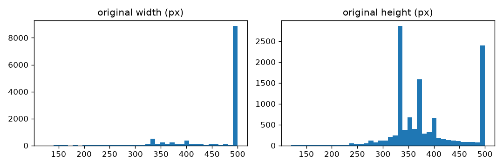
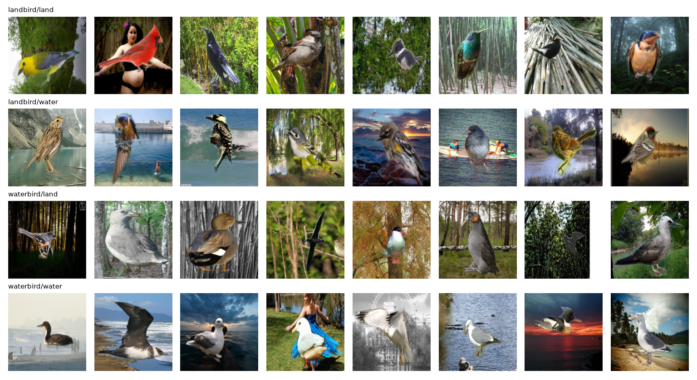

# EDA report

Cache images sha256 `f0b3b397117af0e2`, splits sha256 `3302b0617daa85a1`, 11788 images.

## 1. Official split counts

| split | group | observed | expected | match |
|---|---|---|---|---|
| train | landbird/land | 3498 | 3498 | True |
| train | landbird/water | 184 | 184 | True |
| train | waterbird/land | 56 | 56 | True |
| train | waterbird/water | 1057 | 1057 | True |
| val | landbird/land | 467 | 467 | True |
| val | landbird/water | 466 | 466 | True |
| val | waterbird/land | 133 | 133 | True |
| val | waterbird/water | 133 | 133 | True |
| test | landbird/land | 2255 | 2255 | True |
| test | landbird/water | 2255 | 2255 | True |
| test | waterbird/land | 642 | 642 | True |
| test | waterbird/water | 642 | 642 | True |

All match the official release: **True**

## 2. Whole pool (label x background)

| y | land | water |
|---|---|---|
| landbird | 6220 | 2905 |
| waterbird | 831 | 1832 |

## 3. Controlled splits (validated: counts, disjointness, nesting)

Fixed test: 1200 images; fixed val_bal: 400. Seeds: ['0', '1', '2', '3', '4']. Per-seed rows are in controlled_summary.csv; first seed shown.

| rho | train_minority_per_class | realized_rho_landbirds | realized_rho_waterbirds | val_id_landbird/land | val_id_landbird/water | val_id_waterbird/land | val_id_waterbird/water |
|---|---|---|---|---|---|---|---|
| 0.500 | 300 | 0.500 | 0.500 | 100 | 100 | 100 | 100 |
| 0.800 | 120 | 0.800 | 0.800 | 160 | 40 | 40 | 160 |
| 0.900 | 60 | 0.900 | 0.900 | 180 | 20 | 20 | 180 |
| 0.950 | 30 | 0.950 | 0.950 | 190 | 10 | 10 | 190 |
| 0.990 | 6 | 0.990 | 0.990 | 198 | 2 | 2 | 198 |

## 4. Integrity checks

- Background images shared between any train/val_id set and test: 0
- ... and between any train/val_id set and val_bal: 0
- Files with byte-identical duplicates: 0 (0 distinct contents); duplicate groups spanning test/val_bal/train pool: 0

## 5. Original image sizes (median per group)

| group | orig_width | orig_height |
|---|---|---|
| landbird/land | 500.000 | 375.000 |
| landbird/water | 500.000 | 375.000 |
| waterbird/land | 500.000 | 354.000 |
| waterbird/water | 500.000 | 358.000 |

## 6. Figures

